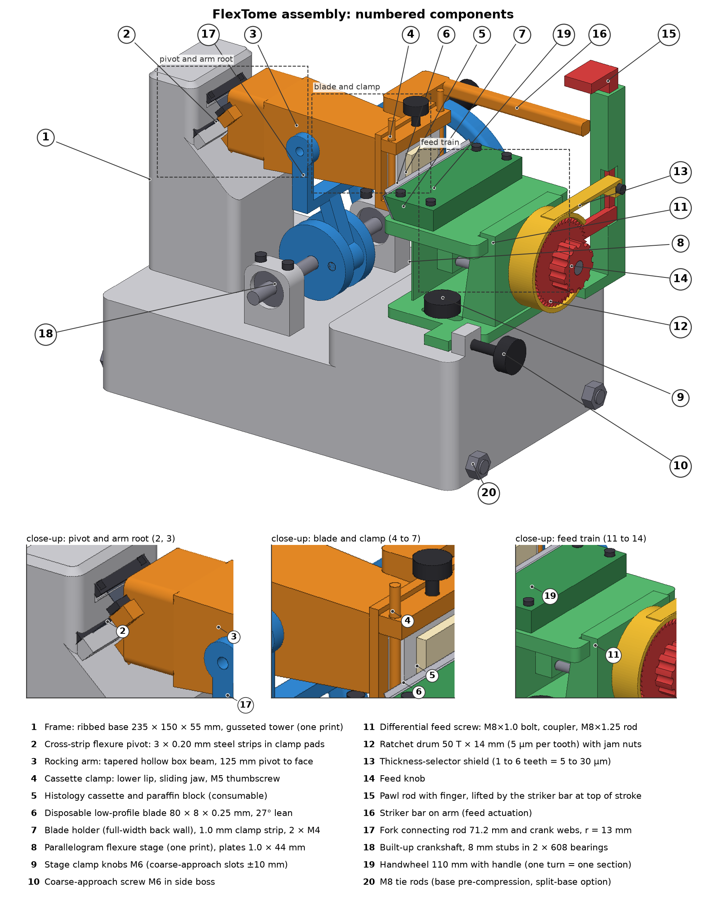
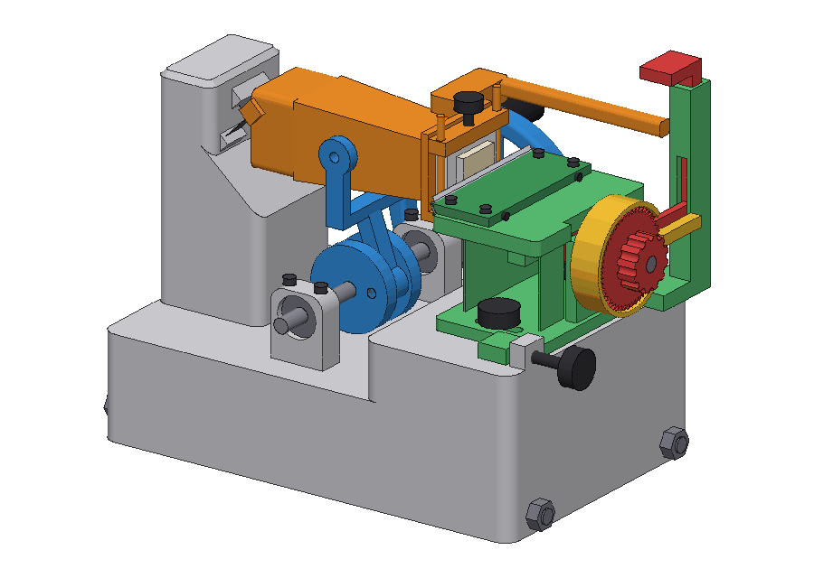
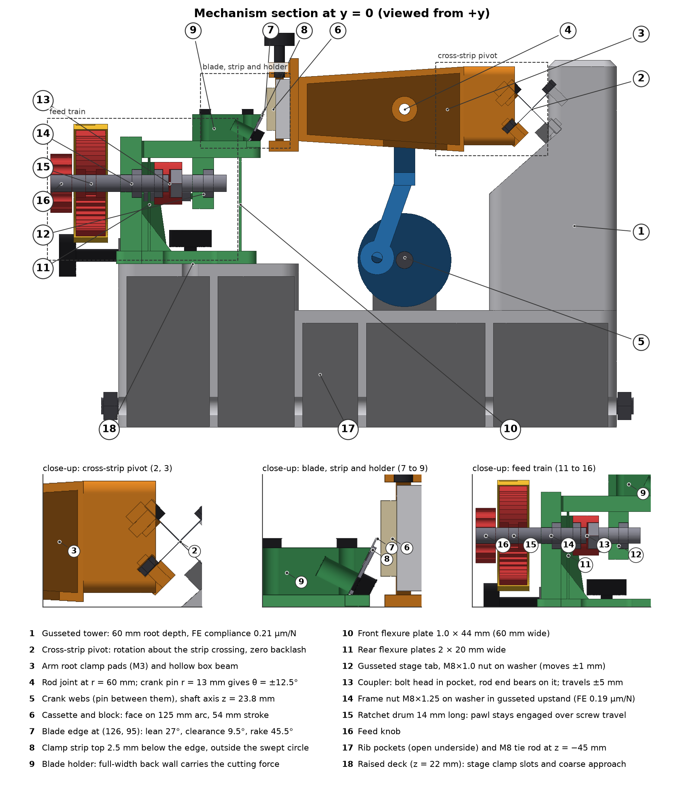

# FlexTome, a 3D-printed, flexure-pivot rocking microtome with a differential-screw feed

**Design study (revision 2) for a US$61.97 microtome that targets 5 µm paraffin histology sections**: a rocking-arm microtome whose arm pivot is a cross-strip steel flexure (no backlash), whose 5 µm feed comes from a differential screw built from two standard M8 threads (0.25 mm/rev ÷ 50-tooth ratchet), and whose blade rides a monolithic printed parallelogram flexure stage. Everything except the fasteners, bearings, feeler-gauge strips and blade is printed on a 235 mm-bed FDM printer.



| | |
|---|---|
| Predicted section thickness | 5.01 ± 0.72 µm (1 s.d.) at the 5 µm setting (90 % interval 3.84 to 6.19 µm); 10.01 ± 0.78 µm at 10 µm; thread-lead bias within ±0.7 % per machine (Monte-Carlo, every error as a stroke-to-stroke difference) |
| Metrology-loop stiffness | 0.83 N/µm (1.20 µm/N; analytic + plane-stress FE of stage, frame-nut upstand and frame on two end pads) |
| Stroke | 54 mm arc at ±12.5°, one section per handwheel turn; 20 mm face cut in 118 ms |
| Feed | 0.25 mm/rev differential (M8×1.25 / M8×1.0), 5 µm per ratchet tooth, selector 5–30 µm |
| Bill of materials | US$61.97 (16 printed part types / 20 pieces, 1.40 L PLA solid-modelled upper bound, US$34.57; hardware US$24.80; consumables US$2.60; `bom/make_bom.py`) |
| Status | **Design and analysis only, not yet built or measured.** A validation protocol is in the paper. |



## Repository layout

| Path | Contents |
|---|---|
| `paper/` | `flextome_paper.pdf` (22 pp), `flextome_summary.pdf` (2-page presentation summary) and LaTeX sources (`flextome_paper.tex`, `mechanism_section.tex`, `flextome_summary.tex`, `flextome.bib`, `figures/`). Compiles with `tectonic` or on Overleaf (pdfLaTeX + BibTeX). |
| `docs/` | `flextome_mechanics_explainer.md` (plain-language mechanics walkthrough), ISEF abstract + assembly instructions, verified reference list (`references.csv`, 64 CrossRef-resolved + 10 web sources) and `evidence_summary.md`. |
| `cad/` | `flextome_cad.py`, the parametric CadQuery model (edit the constants at the top and re-run); `step/flextome_assembly.step` (32 components); `stl/` one STL per part; `parts.json` (name, colour, material, qty, printed?, volume). |
| `analysis/` | `flextome_design.py` (kinematics, flexure pivot, differential screw, stage flexure, loop compliance, thermal drift, Monte-Carlo budget), `fea_stage.py` / `fea_upstand.py` / `fea_frame.py` (scikit-fem plane stress), `extra_analysis.py` (cutting-force bracket, modes, entry transient, levers, sensitivity), figure scripts, and all result JSONs. |
| `render/` | `render.py` (numpy z-buffer STL renderer with feature edges, no OpenGL), `pose.py` (loop-closure posing), `render_all.py`, `make_drawings.py` (numbered callouts). |
| `figures/` | All figures: callout drawings, mechanics explainer figures (M1–M5), analysis figures, CAD renders, poses, animation. |
| `bom/` | `flextome_bom.csv` and the script that generates it, `make_bom.py`. |

## How it works (short version)



1. **Drive**, handwheel → built-up crankshaft (two 8 mm stubs in 608 bearings, two printed webs, 5 mm pin at r = 13 mm) → fork connecting rod (71.2 mm, running between the webs) → arm joint 60 mm from the pivot. The crank centre sits exactly one rod length below the joint, so `sin θmax = 13/60 → ±12.5°`, stroke 54.2 mm.
2. **Pivot**, three 0.20 mm feeler-gauge strips (10/20/10 mm wide, 20 mm free length) crossing at 90°: kθ = 0.27 N·m/rad, 218 MPa at full swing (fatigue SF 2.1), 40 N/µm axially, no backlash.
3. **Cut**, disposable blade at 27° lean: clearance 9.5° (4.9–14.1° over the arc), rake 45.5°. The face is trimmed to the 125 mm arc once; successive sections are uniform.
4. **Feed**, the *blade* moves: M8×1.25 in the frame nut, M8×1.0 in the stage-tab nut → 0.25 mm/rev; 50-tooth, 14 mm drum ratchet → 5 µm/tooth; selector shield exposes 1–6 teeth. Only the pitch *difference* matters, so hardware-store threads suffice.
5. **Actuation**, a striker bar on the arm lifts a pawl rod past θ ≈ 6° on the up-stroke; the pawl rides over *k* teeth and indexes the drum on the way down, before the face reaches the edge.
6. **Force path**, edge → overhang → holder → platform → flexure plates → nut → screw → frame nut → base → tower → pivot → arm → block: 1.00 µm/N in series; a steady cutting force is trimmed into the face, only its stroke-to-stroke variation (0.4 N s.d. → 0.40 µm) enters the thickness.

Full derivations, equations and numbers: `paper/flextome_paper.pdf` Sec. 3 and `docs/flextome_mechanics_explainer.md`. What changed between revisions and why: paper Sec. 2.6 and Table 2.

## Reproducing

```bash
conda create -n flextome -c conda-forge python=3.11 cadquery numpy scipy matplotlib pandas pillow
conda activate flextome && pip install scikit-fem
python cad/flextome_cad.py            # → stl/, step/, parts.json
python cad/audit_interference.py      # collision + connectivity audit → audit_results.json
python analysis/flextome_design.py    # → design_results.json (kinematics, pivot, stage, loop, Monte-Carlo)
python analysis/fea_stage.py && python analysis/fea_upstand.py && python analysis/fea_frame.py
python analysis/extra_analysis.py && python bom/make_bom.py
python render/render_all.py           # renders, poses, animation (run from a directory containing stl/ and parts.json)
```

## Printing notes
- Frame: 235 × 150 × 173 mm, print upside-down (open rib pockets up), 0.2 mm layers, ≥4 perimeters, 100 % infill in the tower/gusset and deck; or split at the deck step (x = 110 mm) and clamp the halves with the two M8 tie rods.
- Stage flexure: print with plates vertical, 0.1 mm layers, 100 % infill; PETG or ASA preferred over PLA for creep.
- Pivot strips and pressure strip: cut from a 0.20 mm and a 1.0 mm feeler-gauge blade; deburr; clamp with M3 screws into heat-set inserts.
- All micrometre-critical parts are steel: feed rod/bolt, nuts, strips, blade. Printed parts need only ±0.2 mm.


## Limitations
No physical build yet, so every performance number is a prediction. The feed-axis cutting force and its per-stroke variation are assumptions bracketed by a fracture model (no absolute paraffin value exists in the literature); nut-bedding stiffness and the PLA creep limit are allowances; the frame's support condition (full contact vs two end pads) changes its term by 0.14 µm/N and the conservative case is used. Revision 1 of this repository claimed 1.00 µm/N and 5.0 ± 0.6 µm; an independent review showed that budget did not match the drawn load path (the ungusseted upstand alone was 7.3 µm/N). See the paper's Sec. 2.6, Discussion and Validation plan.

## License
Hardware design files (CAD, STL, STEP, BOM): CERN-OHL-P v2. Source code: MIT. Documentation and figures: CC BY 4.0. See `LICENSE`.
